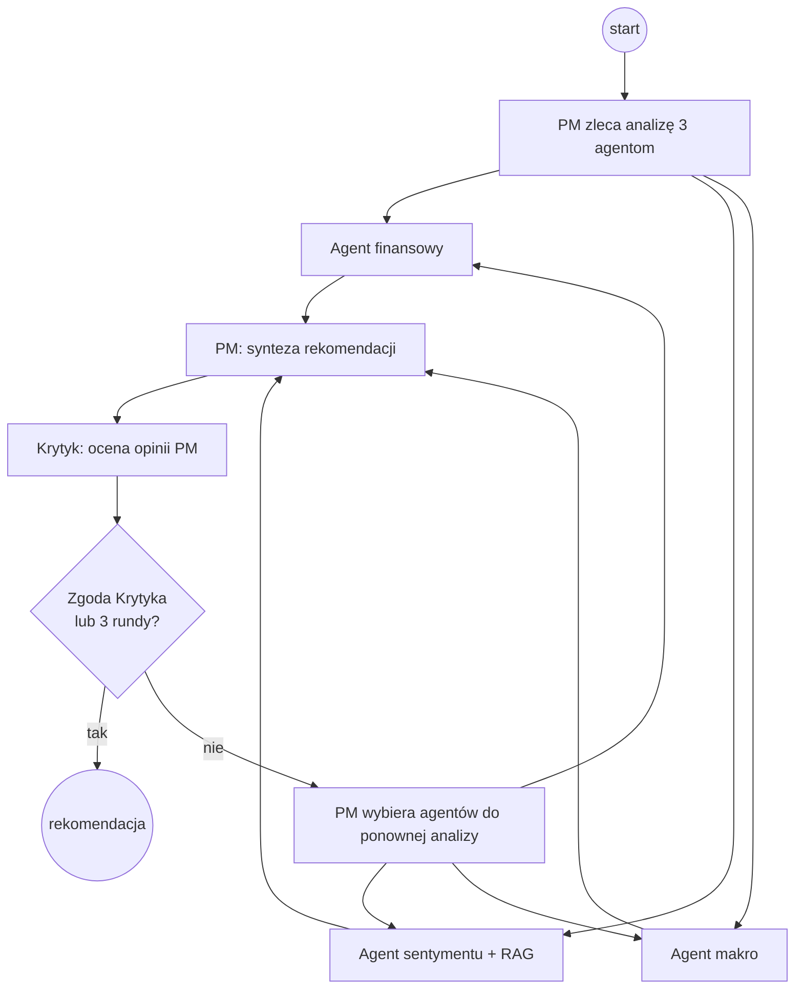
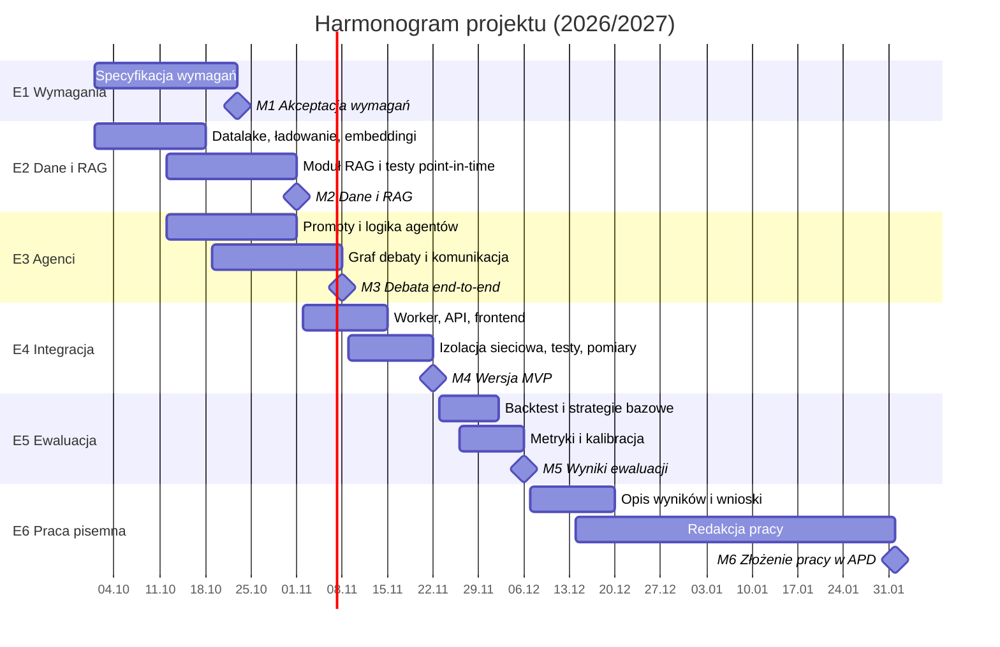

# Dokument Etapu 1: Specyfikacja wymagań i zakres projektu

| | |
| :--- | :--- |
| **Tytuł projektu** | Wieloagentowy system do rekomendacji tradingu z wykorzystaniem RAG |
| **Autorzy** | Piotr Wysocki, Miłosz Zieliński |
| **Promotor** | dr inż. Jan Sawicki – Zakład Sztucznej Inteligencji i Metod Obliczeniowych, Wydział MiNI, Politechnika Warszawska |
| **Kierunek** | Inżynieria i Analiza Danych – praca dyplomowa inżynierska |
| **Data** | 20.10.2026 |
| **Wersja** | 1.0 |

---

## Streszczenie

Dokument definiuje wymagania i zakres pracy inżynierskiej, której celem jest stworzenie wieloagentowego systemu wykorzystującego RAG do generowania rekomendacji tradingowych (BUY / HOLD / SELL) na podstawie aktualnych i historycznych danych rynkowych oraz ocena jego skuteczności. Opisano tło i cele biznesowe projektu oraz ich przełożenie na cele eksploracji danych, wizję systemu, słownik pojęć, założenia i ograniczenia, dostępne zasoby, wymagania funkcjonalne i niefunkcjonalne, harmonogram z diagramem Gantta i podziałem pracy, analizę ryzyka SWOT, przypadki użycia oraz kryteria sukcesu. Dokument stanowi podstawę do uzgodnienia zakresu pracy z promotorem i punkt odniesienia dla kolejnych etapów projektu.

---

## Historia zmian

| Wersja | Data | Autor | Zakres zmian |
| :---: | :---: | :--- | :--- |
| **1.0** | 19.10.2026 | Miłosz Zieliński | Pełna specyfikacja: cel biznesowy, wizja, wymagania, ryzyka, harmonogram, podział pracy. |

---

## Spis treści

1. [Podsumowanie wykonawcze](#1-podsumowanie-wykonawcze)
   1. Tło i cel projektu
   2. Cele biznesowe
   3. Cele eksploracji danych z perspektywy biznesu
   4. Wizja systemu
   5. Zakres projektu
2. [Słownik pojęć](#2-słownik-pojęć)
3. [Wymagania](#3-wymagania)
   1. Założenia
   2. Ograniczenia
   3. Inwentarz zasobów
   4. Wymagania funkcjonalne
   5. Wymagania niefunkcjonalne
4. [Harmonogram projektu](#4-harmonogram-projektu)
   1. Kalendarz kamieni milowych
   2. Diagram Gantta
   3. Podział pracy
5. [Analiza ryzyka](#5-analiza-ryzyka)
6. [Przypadki użycia](#6-przypadki-użycia)
7. [Kryteria sukcesu](#7-kryteria-sukcesu)

---

## 1. Podsumowanie wykonawcze

### 1.1. Tło i wizja projektu

Inwestor indywidualny lub analityk podejmujący decyzję o zakupie lub sprzedaży akcji musi zestawić dane o bardzo różnym charakterze: sprawozdania finansowe spółki, notowania cenowe, dziesiątki artykułów prasowych oraz wskaźniki makroekonomiczne. Ręczna analiza jest czasochłonna i podatna na błędy poznawcze. Duże modele językowe (LLM) potrafią syntetyzować takie informacje, ale pytane „wprost” mają skłonność do halucynacji, nie znają danych bieżących, a w zastosowaniach finansowych łatwo o błąd metodologiczny polegający na „podglądaniu przyszłości” (*lookahead bias*).

**Celem pracy jest stworzenie wieloagentowego systemu wykorzystującego RAG do generowania rekomendacji tradingowych na podstawie aktualnych i historycznych danych rynkowych oraz ocena jego skuteczności.** System odpowiada na opisane problemy dwoma mechanizmami: **RAG** – agenci odpowiadają na podstawie danych pobranych z bazy, a nie wyłącznie z wiedzy modelu – oraz **architekturą wieloagentową** – wyspecjalizowani agenci (finansowy, sentymentu i makroekonomiczny) analizują różne wymiary spółki, a Portfolio Manager i Krytyk prowadzą debatę naśladującą proces decyzyjny w funduszu inwestycyjnym. Wynikiem jest rekomendacja BUY / HOLD / SELL z poziomem pewności, której jakość jest weryfikowana na danych historycznych na tle prostych strategii bazowych. W ramach pracy analizowana jest także współpraca agentów, metody łączenia różnych źródeł danych oraz ograniczenia i ryzyka związane z zastosowaniem AI w tradingu.

### 1.2. Cele biznesowe

| ID | Cel biznesowy | Uzasadnienie |
| :---: | :--- | :--- |
| **CB-1** | Skrócenie czasu analizy spółki z godzin do minut. | Jedna analiza automatycznie obejmuje dane fundamentalne, sentyment wiadomości i kontekst makroekonomiczny. |
| **CB-2** | Przejrzystość i wyjaśnialność rekomendacji. | Użytkownik widzi nie tylko decyzję, ale też uzasadnienie, raporty agentów, uwagi Krytyka i artykuły źródłowe. |
| **CB-3** | Ograniczenie halucynacji modelu. | Odpowiedzi agentów są ugruntowane w danych pobranych z bazy (RAG, zapytania SQL). |
| **CB-4** | Wiarygodna, zmierzona skuteczność. | Użytkownik zna historyczną trafność rekomendacji z rzetelnego backtestu, zamiast polegać na deklaracjach. |

**Interesariusze:** inwestor indywidualny / analityk (użytkownik docelowy), zespół dyplomowy (badacze), promotor i komisja egzaminacyjna (ocena rzetelności wyników).

### 1.3. Cele eksploracji danych z perspektywy biznesu

Cele biznesowe przekładają się na następujące zadania analityczne:

| ID | Cel eksploracji danych | Typ zadania | Wspiera |
| :---: | :--- | :--- | :---: |
| **CED-1** | Przewidywanie kierunku zmiany ceny akcji w horyzoncie 1 tygodnia, 1 miesiąca lub 3 miesięcy jako klasy **BUY / HOLD / SELL** wraz z poziomem pewności 0–1. | Klasyfikacja wieloklasowa (LLM + debata agentów) | CB-1, CB-4 |
| **CED-2** | Ekstrakcja sentymentu z wiadomości finansowych dla danej spółki i daty. | Analiza sentymentu tekstu | CB-2, CB-3 |
| **CED-3** | Wyszukiwanie artykułów najbardziej istotnych dla bieżącego pytania agenta. | Wyszukiwanie semantyczne (embeddingi, podobieństwo kosinusowe) | CB-3 |
| **CED-4** | Synteza sygnałów fundamentalnych, makroekonomicznych i sentymentu w jedną rekomendację z uzasadnieniem. | Fuzja informacji z wielu źródeł (debata wieloagentowa) | CB-2 |
| **CED-5** | Ocena skuteczności rekomendacji względem strategii bazowych. | Backtest, kalibracja pewności | CB-4 |

### 1.4. Wizja systemu

Użytkownik wybiera spółkę (ticker), horyzont inwestycyjny (`1W` / `1M` / `3M`) oraz datę analizy (`as_of_date`). Uruchamiana jest asynchroniczna debata agentów LLM, w której każdy agent widzi wyłącznie dane dostępne do dnia `as_of_date`. Przebieg debaty można obserwować na żywo w interfejsie webowym, a wynikiem jest rekomendacja z uzasadnieniem.

**Agenci i ich role**

| Agent | Rola | Źródło danych |
| :--- | :--- | :--- |
| **Portfolio Manager (PM)** | Zleca analizy, syntetyzuje raporty w rekomendację BUY / HOLD / SELL z pewnością 0–1; w kolejnych rundach wybiera agentów do ponownej analizy. | Raporty agentów, uwagi Krytyka |
| **Krytyk** | Weryfikuje spójność i bezstronność opinii PM; decyduje o zakończeniu debaty lub kolejnej rundzie (maks. 3 rundy). | Opinia PM, raporty agentów |
| **Agent finansowy** | Analiza fundamentalna i cenowa spółki. | SQL: `fundamentals`, `stock_prices` |
| **Agent sentymentu** | Ocena nastrojów na podstawie 10 najnowszych artykułów oraz do 3 zapytań wyszukiwania semantycznego na rundę. | RAG: `article_summaries` (pgvector) |
| **Agent makroekonomiczny** | Ocena otoczenia makroekonomicznego (stopy procentowe, inflacja, PKB, krzywa rentowności). | SQL: `macro_series` (FRED) |

**Przebieg debaty**

### 1.5. Zakres projektu

**W zakresie (MVP):**

1. Skrypty pobierające dane (Alpha Vantage, Yahoo Finance, FRED) i ich ładowanie do bazy wraz z embeddingami artykułów.
2. Moduł RAG – wyszukiwanie semantyczne artykułów z filtrem point-in-time.
3. Debata 5 agentów w LangGraph z ustrukturyzowanym wyjściem i limitem 3 rund.
4. REST API z asynchroniczną kolejką zadań oraz interfejs webowy (nowa analiza, debata na żywo, wynik, historia).
5. Backtest w izolowanym sieciowo środowisku: strategie bazowe, metryki, kalibracja.

**Poza zakresem (prace przyszłe):** automatyczne cykliczne pobieranie danych, składanie zleceń u brokera, prognoza ceny docelowej (regresja), nowe spółki i rynki, konta użytkowników i wdrożenie produkcyjne.

---

## 2. Słownik pojęć

| Termin | Definicja |
| :--- | :--- |
| **Agent** | Wyspecjalizowany komponent systemu oparty na modelu językowym, odpowiedzialny za jeden obszar analizy (np. dane finansowe, sentyment, makroekonomia). |
| **RAG** | *Retrieval-Augmented Generation* – podejście, w którym model językowy odpowiada na podstawie dokumentów wyszukanych w bazie wiedzy, a nie wyłącznie własnej wiedzy. |
| **Rekomendacja BUY / HOLD / SELL** | Wynik działania systemu: kupuj / trzymaj / sprzedaj, wraz z poziomem pewności i uzasadnieniem. |
| **Ticker** | Skrócony symbol giełdowy spółki, np. `AAPL` dla Apple Inc. |
| **Horyzont inwestycyjny** | Okres, którego dotyczy rekomendacja: 1 tydzień, 1 miesiąc lub 3 miesiące. |
| **Sentyment** | Wydźwięk (pozytywny, neutralny, negatywny) wiadomości lub nastrojów rynkowych wobec spółki. |
| **Data analizy (`as_of_date`)** | Dzień, na który wykonywana jest analiza; system widzi tylko dane opublikowane do tego dnia włącznie. |

---

## 3. Wymagania

### 3.1. Założenia

| ID | Założenie |
| :---: | :--- |
| **Z-1** | Analizowane jest 9 spółek z rynku amerykańskiego: AAPL, CAT, GS, INTC, META, NFLX, NVDA, SMCI, TSLA. |
| **Z-2** | Okno backtestu obejmuje okres 01.01.2025 – 30.06.2026; horyzonty rekomendacji to 1 tydzień, 1 miesiąc i 3 miesiące. |
| **Z-3** | Rekomendacja ma postać klasyfikacji kierunku (BUY / HOLD / SELL) z pewnością 0–1 – bez prognozy ceny docelowej. |
| **Z-4** | Dane są pobierane jednorazowo i przechowywane w datalake; system nie pobiera danych w trakcie analizy. |
| **Z-5** | Agenci widzą dane do `as_of_date` włącznie (np. wiadomości z dnia analizy są dostępne). |
| **Z-6** | System jest narzędziem badawczym wspierającym decyzje, a nie doradztwem inwestycyjnym. |

### 3.2. Ograniczenia

| ID | Ograniczenie | Konsekwencja |
| :---: | :--- | :--- |
| **O-1** | Data końca wiedzy treningowej LLM musi poprzedzać początek okna backtestu (01.01.2025). | Wybór Llama 3.3 70B; nowsze modele Gemini są wykluczone. |
| **O-2** | Limity darmowego planu Alpha Vantage (liczba zapytań dziennie). | Pobieranie danych rozłożone w czasie, wyniki zapisywane trwale w datalake. |
| **O-3** | Ograniczony budżet chmury GCP. | Limit 3 rund debaty i 3 zapytań RAG na rundę; pomiar kosztu na próbie pilotażowej przed pełnym backtestem. |
| **O-4** | Zespół 2 osób i jeden semestr na realizację. | Ścisłe rozdzielenie MVP i prac przyszłych. |
| **O-5** | Mała próba (9 spółek, ok. 18 miesięcy). | Ograniczona istotność statystyczna wyników; konieczność raportowania przedziałów ufności. |
| **O-6** | Artykuły wyłącznie w języku angielskim. | Model embeddingów `text-embedding-005` wyspecjalizowany w języku angielskim. |

### 3.3. Inwentarz zasobów

| Kategoria | Zasób |
| :--- | :--- |
| **Dane** | Alpha Vantage: dane fundamentalne, notowania, wiadomości (`NEWS_SENTIMENT`, trafność ≥ 0,9); Yahoo Finance: notowania dzienne; FRED: FEDFUNDS, GDP, CPIAUCSL, PPIACO, T10Y2Y, DGS10. |
| **Usługi chmurowe** | Google Cloud – Vertex AI: Llama 3.3 70B Instruct (MaaS), `text-embedding-005` (768 wymiarów). |
| **Oprogramowanie** | Python 3.12, `uv`, FastAPI, LangGraph, Celery, Redis, PostgreSQL 16 + pgvector, SQLAlchemy, Streamlit, Docker Compose, squid (proxy backtestu), pytest, ruff. |
| **Sprzęt** | Prywatne komputery członków zespołu (uruchamianie stosu Docker lokalnie); obliczenia LLM w chmurze, bez potrzeby GPU. |
| **Narzędzia zespołowe** | GitHub (repozytoria kodu, datalake i dokumentacji), GitHub Actions (CI). |

### 3.4. Wymagania funkcjonalne

| ID | Wymaganie | 
| :---: | :--- | 
| **FR-01** | System pobiera dane cenowe, fundamentalne, wiadomości i dane makro z zewnętrznych API do datalake (skrypty CLI). | 
| **FR-02** | System ładuje dane z datalake do bazy i wylicza embeddingi artykułów. | 
| **FR-03** | Użytkownik może uruchomić analizę dla tickera, horyzontu i daty `as_of_date` z okna backtestu. | 
| **FR-04** | Agenci finansowy i makro pobierają dane wyłącznie do `as_of_date` włącznie. | 
| **FR-05** | Agent sentymentu korzysta z RAG: 10 najnowszych artykułów + do 3 zapytań semantycznych na rundę (do 5 artykułów na zapytanie, podobieństwo ≥ 0,5). |
| **FR-06** | PM generuje rekomendację: kierunek BUY / HOLD / SELL, pewność 0–1, podsumowanie i argumenty. | 
| **FR-07** | Krytyk ocenia opinię PM; przy braku zgody PM ponownie odpytuje wybranych agentów, maksymalnie 3 rundy. | 
| **FR-08** | Użytkownik może śledzić przebieg debaty na żywo. | 
| **FR-09** | Użytkownik może przejrzeć historię zakończonej debaty i wynik. | 
| **FR-10** | Każdy wynik zawiera `as_of_date` i `model_version`. | 
| **FR-11** | Moduł ewaluacji uruchamia backtest i liczy metryki względem strategii bazowych. | 

### 3.5. Wymagania niefunkcjonalne

| ID | Kategoria | Docelowa mierzalna metryka | Metoda weryfikacji |
| :---: | :--- | :--- | :--- |
| **NFR-01** | **Brak lookahead bias** | 100% zapytań agentów (SQL i RAG) filtruje dane do `as_of_date`; 0 rekordów z datą późniejszą w kontekście agentów. | Testy jednostkowe i integracyjne zapytań |
| **NFR-02** | **Izolacja sieciowa backtestu** | Worker backtestowy ma dostęp wyłącznie do 2 domen Google z listy dozwolonych; grounding z Google Search wyłączony. | Test `curl` z kontenera; inspekcja żądań do LLM |
| **NFR-03** | **Czas odpowiedzi API** | Endpointy niebędące debatą odpowiadają w czasie < 500 ms (p95). | Test obciążeniowy (Locust / k6) |
| **NFR-04** | **Czas trwania debaty** | Mediana ≤ 3 min, p95 ≤ 6 min (do potwierdzenia pomiarem). | Znaczniki czasu z backtestu |
| **NFR-05** | **Poprawność wyjścia** | ≥ 99% odpowiedzi LLM przechodzi walidację schematów Pydantic. | Logi walidacji |
| **NFR-06** | **Powtarzalność** | Każdy wynik zawiera `as_of_date` i `model_version`; stała temperatura modelu; środowisko uruchamiane przez `docker compose up --build`. | Uruchomienie na czystej maszynie |
| **NFR-07** | **Koszt** | Średni koszt jednej debaty ≤ 0,10 USD. | Raport rozliczeń GCP / zliczanie tokenów |
| **NFR-08** | **Niezawodność** | 0 nieobsłużonych błędów `500`; niedostępność Redis / bazy → `503`; błąd wyszukiwania → status `FAILED`. | Testy API (pytest) |
| **NFR-09** | **Jakość kodu** | Testy krytycznych modułów przechodzą w CI; kod zgodny z `ruff`. | GitHub Actions, pre-commit |
| **NFR-10** | **Bezpieczeństwo i odpowiedzialne użycie** | Brak sekretów w repozytorium; interfejs informuje, że system nie stanowi porady inwestycyjnej. | Przegląd repozytorium i interfejsu |

---

## 4. Harmonogram projektu

### 4.1. Kalendarz kamieni milowych

| ID | Kamień milowy | Termin | Rezultat |
| :---: | :--- | :---: | :--- |
| **M1** | Akceptacja wymagań | 23.10.2026 | Dokument Etapu 1 zaakceptowany przez promotora. |
| **M2** | Dane i RAG | 01.11.2026 | Kompletna baza danych, embeddingi, działające wyszukiwanie semantyczne. |
| **M3** | Debata end-to-end | 08.11.2026 | Pełna debata 5 agentów dla jednej spółki. |
| **M4** | Wersja MVP | 22.11.2026 | System działający w Docker Compose, testy w CI, izolacja sieciowa backtestu. |
| **M5** | Wyniki ewaluacji | 06.12.2026 | Komplet wyników backtestu i kalibracji. |
| **M6** | Złożenie pracy | 01.02.2027 | Praca złożona w APD. |
| **M7** | Obrona | luty 2027 | Prezentacja i demonstracja systemu. |

### 4.2. Diagram Gantta

### 4.3. Podział pracy

| Osoba | Zakres pracy |
| :--- | :--- |
| **Piotr Wysocki** | Implementacja modułu RAG; graf debaty i komunikacja między agentami; klient LLM, prompty oraz logika Portfolio Managera i Krytyka. Wspólnie: architektura systemu i izolacja sieciowa, backtest, metryki i analiza wyników, dokumentacja i redakcja pracy. Udział w testach. |
| **Miłosz Zieliński** | Pobieranie i przetwarzanie danych (API, newsy), baza danych i embeddingi; agent sentymentu – analiza i ocena nastrojów; frontend; testy i CI. Wspólnie: architektura systemu i izolacja sieciowa, backtest, metryki i analiza wyników, dokumentacja i redakcja pracy. |

**Macierz RACI** (R – wykonuje, A – odpowiada za wynik, C – konsultowany, I – informowany)

| Obszar | Wysocki | Zieliński |
| :--- | :---: | :---: |
| Pobieranie danych, baza, embeddingi | C | **R/A** |
| Moduł RAG | **R/A** | C |
| Architektura (Docker, Celery, Redis, API) i izolacja sieciowa | **R/A** | **R/A** |
| Graf debaty i komunikacja między agentami | **R/A** | C |
| Klient LLM, prompty, logika PM i Krytyka | **R/A** | C |
| Agent sentymentu – analiza i ocena nastrojów | C | **R/A** |
| Frontend | C | **R/A** |
| Testy i CI | R | **R/A** |
| Backtest, metryki, analiza wyników | **R/A** | **R/A** |
| Dokumentacja i redakcja pracy | **R/A** | **R/A** |

Zasady współpracy: każda zmiana w kodzie przez pull request z przeglądem drugiej osoby; decyzje projektowe zapisywane w `docs/project_decisions.md`; regularne spotkania zespołu.

---

## 5. Analiza ryzyka

| | **Pozytywne** | **Negatywne** |
| :--- | :--- | :--- |
| **Czynniki wewnętrzne** | **Mocne strony (S)** • Rzetelna metodologia: filtr point-in-time, izolacja sieciowa, model z wiedzą sprzed okna backtestu • Wyjaśnialność – raporty agentów, uwagi Krytyka, artykuły źródłowe • Działający szkielet systemu (dane, RAG, API, testy w CI) | **Słabe strony (W)** • Mała próba: 9 spółek, ok. 18 miesięcy • Niedeterminizm i możliwe halucynacje LLM • Zależność od jednego dostawcy chmury  |
| **Czynniki zewnętrzne** | **Szanse (O)** • Duże zainteresowanie systemami wieloagentowymi i RAG w finansach • Dostęp do nowszych, tańszych modeli w przyszłości • Możliwość rozszerzenia na kolejne rynki i źródła danych • Wyniki (także negatywne) wartościowe badawczo | **Zagrożenia (T)** • Wycofanie lub zmiana dostępności modelu / API • Limity i zmiany warunków dostawców danych • Przekroczenie budżetu chmury • Nadinterpretacja wyników jako porady inwestycyjnej |

---

## 6. Przypadki użycia

| ID | Przypadek użycia | Aktor |
| :---: | :--- | :--- |
| **UC-01** | Uruchomienie analizy spółki | Użytkownik |
| **UC-02** | Podgląd debaty na żywo | Użytkownik |
| **UC-03** | Odczyt rekomendacji z uzasadnieniem | Użytkownik |
| **UC-04** | Wyszukiwanie artykułów (RAG) | Agent sentymentu |
| **UC-05** | Przeprowadzenie backtestu | Zespół badawczy |
| **UC-06** | Aktualizacja danych | Zespół badawczy |

**UC-01: Uruchomienie analizy spółki**

* **Warunki początkowe:** system działa, ticker jest w bazie.
* **Scenariusz główny:** (1) użytkownik wybiera ticker, horyzont i datę `as_of_date`; (2) system waliduje dane i umieszcza zadanie w kolejce; (3) system zwraca identyfikator zadania (`202`, ≤ 500 ms) i przechodzi do widoku debaty.
* **Scenariusze alternatywne:** niepoprawny ticker, horyzont lub przyszła data → `422` z opisem błędu; niedostępna baza lub Redis → `503`.

**UC-02: Podgląd debaty na żywo**

* **Warunki początkowe:** debata jest w toku.
* **Scenariusz główny:** interfejs cyklicznie pobiera status i historię debaty, wyświetlając numer rundy, aktywnych agentów, ich raporty oraz zapytania RAG i znalezione artykuły.

**UC-03: Odczyt rekomendacji z uzasadnieniem**

* **Warunki początkowe:** debata zakończona.
* **Scenariusz główny:** system prezentuje kierunek (BUY / HOLD / SELL), pewność, podsumowanie, liczbę rund, decyzję Krytyka, raporty 3 agentów oraz `as_of_date` i `model_version`.
* **Scenariusz alternatywny:** debata zakończona błędem → status `FAILED` z opisem przyczyny.

**UC-04: Wyszukiwanie artykułów (RAG)**

* **Scenariusz główny:** (1) agent otrzymuje 10 najnowszych artykułów; (2) model zleca do 3 zapytań; (3) system zwraca do 5 artykułów na zapytanie, opublikowanych do `as_of_date`, o podobieństwie ≥ 0,5, bez duplikatów; (4) zapytania i artykuły trafiają do historii debaty.
* **Scenariusz alternatywny:** model nie zleca wyszukiwania lub zwraca niepoprawne argumenty → agent kontynuuje na podstawie najnowszych artykułów.

**UC-05: Przeprowadzenie backtestu**

* **Warunki początkowe:** środowisko backtestu działa z izolacją sieciową.
* **Scenariusz główny:** zespół uruchamia serię analiz dla listy spółek i dat; system zapisuje rekomendacje i generuje raport metryk dla systemu i strategii bazowych.

**UC-06: Aktualizacja danych**

* **Scenariusz główny:** zespół uruchamia skrypty pobierające, a następnie `uv run python -m src.db.load`; dane trafiają do bazy bez duplikatów, a nowe artykuły zostają zwektoryzowane.

---

## 7. Kryteria sukcesu

### 7.1. Kryteria biznesowe

| ID | Kryterium | Wartość docelowa |
| :---: | :--- | :--- |
| **KS-B1** | Czas analizy jednej spółki | Mediana ≤ 3 min od uruchomienia do rekomendacji. |
| **KS-B2** | Wyjaśnialność | 100% rekomendacji zawiera uzasadnienie PM, raporty 3 agentów i decyzję Krytyka. |
| **KS-B3** | Rzetelność metodologiczna | 0 przypadków dostępu do danych późniejszych niż `as_of_date`. |

### 7.2. Kryteria eksploracji danych

| ID | Kryterium | Wartość docelowa |
| :---: | :--- | :--- |
| **KS-D1** | Kompletność ewaluacji | Backtest dla 9 spółek w całym oknie 2025-01-01 – 2026-06-30, dla co najmniej jednego horyzontu. |
| **KS-D2** | Porównanie ze strategiami bazowymi | Raport trafności kierunkowej, precision/recall per klasa, skumulowanej stopy zwrotu i max drawdown dla systemu oraz strategii losowej, momentum i *buy-and-hold*. |
| **KS-D3** | Przewaga nad strategią losową | Trafność kierunkowa systemu wyższa niż strategii losowej (z przedziałem ufności). |
| **KS-D4** | Kalibracja pewności | Wykres kalibracji: trafność w przedziałach `confidence`. |

### 7.3. Kryteria techniczne

| ID | Kryterium | Wartość docelowa |
| :---: | :--- | :--- |
| **KS-T1** | Uruchomienie systemu | Pełny stos uruchamia się poleceniem `docker compose up --build` na czystej maszynie. |
| **KS-T2** | Testy | Wszystkie testy jednostkowe przechodzą w CI. |
| **KS-T3** | Spełnienie wymagań | Wszystkie wymagania o priorytecie *Must* zrealizowane i zweryfikowane. |
