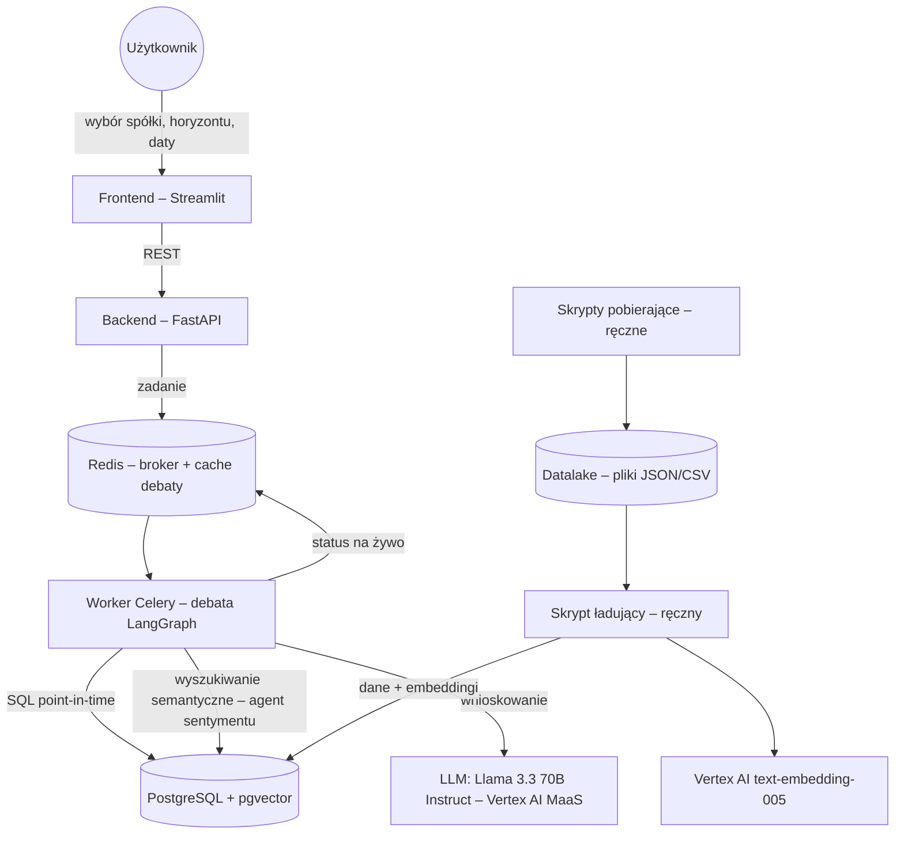
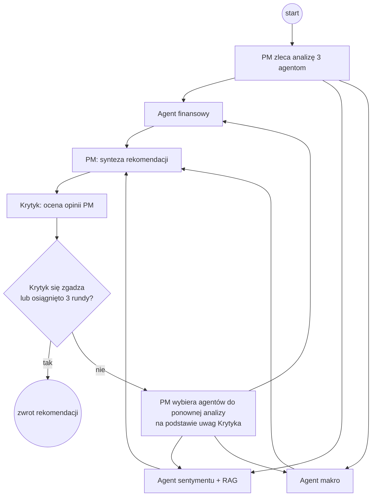

# Dokument Etapu 1: Specyfikacja wymagań i zakres projektu

**Projekt inżynierski – Wydział Matematyki i Nauk Informacyjnych, Politechnika Warszawska**

---

## 1. Metadane dokumentu i historia zmian

| Wersja | Data | Autor | Opis zmiany |
| :---: | :---: | :---: | :--- |
| **0.1** | 15.10.2026 | Miłosz Zieliński | Szablon dokumentu (przetłumaczony na język polski) |
| **1.0** | 19.10.2026 | Piotr Wysocki, Miłosz Zieliński | Pełna specyfikacja: cel biznesowy, wizja, wymagania, ryzyka, harmonogram, podział pracy – wersja do akceptacji promotora |

### 1.1. Dane pracy

| Pole | Wartość |
| :--- | :--- |
| **Tytuł pracy (PL)** | *Wieloagentowy system do rekomendacji tradingu z wykorzystaniem RAG* |
| **Tytuł pracy (EN)** | *A multi-agent trading recommendation system using RAG* |
| **Rodzaj pracy** | Praca dyplomowa inżynierska (zespołowa) |
| **Kierunek studiów** | Inżynieria i Analiza Danych |
| **Liczba osób w zespole** | 2 |
| **Dyplomanci** | Piotr Wysocki, Miłosz Zieliński |
| **Nazwa robocza systemu** | MAS – *Multi-Agent Financial System* |

### 1.2. Promotor

| Pole | Wartość |
| :--- | :--- |
| **Imię i nazwisko, tytuł, stopień naukowy** | dr inż. Jan Sawicki |
| **E-mail** | jan.sawicki@pw.edu.pl |
| **Instytucja** | Politechnika Warszawska |
| **Wydział** | Wydział Matematyki i Nauk Informacyjnych (MiNI) |
| **Zakład** | Zakład Sztucznej Inteligencji i Metod Obliczeniowych |

---

## 2. Cel pracy i sformułowanie problemu

### 2.1. Cel pracy

Celem pracy jest stworzenie wieloagentowego systemu wykorzystującego RAG do generowania rekomendacji tradingowych na podstawie aktualnych i historycznych danych rynkowych oraz ocena jego skuteczności.

### 2.2. Jednozdaniowe sformułowanie problemu inżynierskiego / badawczego

> *„Celem projektu jest zaprojektowanie, implementacja i eksperymentalna ewaluacja skonteneryzowanego systemu wieloagentowego, w którym wyspecjalizowani agenci LLM (fundamentalny, sentymentu i makroekonomiczny), nadzorowani przez Portfolio Managera i Krytyka, prowadzą debatę opartą na danych pobieranych metodą RAG z bazy point-in-time, generując rekomendację BUY / HOLD / SELL z poziomem pewności, której jakość jest weryfikowana w backteście wolnym od lookahead bias na tle prostych strategii bazowych.”*

### 2.3. Tematyka pracy

Praca koncentruje się na opracowaniu wieloagentowego systemu wspierającego decyzje tradingowe z wykorzystaniem podejścia RAG. System integruje modele językowe z aktualnymi i historycznymi danymi rynkowymi, takimi jak notowania giełdowe oraz wiadomości finansowe, aby generować kontekstowe rekomendacje inwestycyjne. W ramach pracy analizowana jest architektura agentów, ich współpraca oraz metody przetwarzania i łączenia różnych źródeł danych. Istotnym elementem jest także ocena jakości rekomendacji oraz identyfikacja ograniczeń i ryzyk związanych z zastosowaniem AI w tradingu.

### 2.4. Pytania badawcze

* **PB-1:** Czy rekomendacje generowane przez debatę agentów osiągają wyższą trafność kierunkową (*hit rate*) niż strategie bazowe: losowa, momentum oraz *buy-and-hold*?
* **PB-2:** Czy struktura wieloagentowa (debata + Krytyk) wnosi wartość w porównaniu z wariantami okrojonymi (pojedynczy agent, brak Krytyka), co pokazuje analiza ablacyjna?
* **PB-3:** Czy deklarowana przez model pewność (`confidence`) jest skalibrowana, tzn. czy rekomendacje o wyższej pewności są częściej trafne?
* **PB-4:** Czy wyszukiwanie semantyczne artykułów (RAG) poprawia jakość analizy sentymentu względem samego zestawu najnowszych wiadomości?

---

## 3. Cel biznesowy

### 3.1. Problem

Inwestor indywidualny lub analityk podejmujący decyzję o zakupie lub sprzedaży akcji musi zestawić ze sobą dane o bardzo różnym charakterze: sprawozdania finansowe spółki, notowania cenowe, dziesiątki artykułów prasowych oraz wskaźniki makroekonomiczne. Ręczna analiza jest czasochłonna, podatna na błędy poznawcze (np. *confirmation bias*), a pojedynczy model językowy pytany „wprost” ma skłonność do halucynacji i nie ma dostępu do aktualnych danych.

### 3.2. Wartość dostarczana przez system

1. **Oszczędność czasu:** jedna analiza obejmuje automatycznie dane fundamentalne, sentyment wiadomości i kontekst makroekonomiczny – w czasie liczonym w minutach zamiast godzin.
2. **Przejrzystość decyzji:** rekomendacja zawsze zawiera uzasadnienie, raporty poszczególnych agentów, uwagi Krytyka i listę artykułów, na których oparto analizę sentymentu – użytkownik widzi *dlaczego*, a nie tylko *co*.
3. **Ugruntowanie w danych (RAG):** agenci odpowiadają na podstawie danych pobranych z bazy, a nie wyłącznie z wiedzy modelu, co ogranicza halucynacje.
4. **Kontrola jakości przez debatę:** Krytyk weryfikuje opinię Portfolio Managera i może wymusić kolejną rundę analizy, co naśladuje proces decyzyjny w funduszu inwestycyjnym.
5. **Mierzalna wiarygodność:** system jest weryfikowany w rzetelnym backteście, więc użytkownik zna historyczną trafność rekomendacji zamiast polegać na deklaracjach.

### 3.3. Interesariusze

| Interesariusz | Potrzeba |
| :--- | :--- |
| **Inwestor indywidualny / analityk** (użytkownik docelowy) | Szybka, uzasadniona rekomendacja dla wybranej spółki i horyzontu inwestycyjnego. |
| **Badacz / zespół dyplomowy** | Powtarzalne środowisko do backtestu i porównania wariantów architektury agentów. |
| **Promotor / komisja egzaminacyjna** | Weryfikowalne wyniki, jasna metodologia ewaluacji i świadomość ograniczeń. |

### 3.4. Mierniki sukcesu projektu

| ID | Miernik | Wartość docelowa |
| :---: | :--- | :--- |
| **KPI-1** | Kompletność ewaluacji | Backtest wykonany dla wszystkich 9 spółek w oknie 01.01.2025 – 30.06.2026, dla co najmniej jednego horyzontu, wraz z porównaniem do 3 strategii bazowych. |
| **KPI-2** | Analiza ablacyjna | Wykonane co najmniej 4 warianty ablacyjne (bez agenta finansowego, sentymentu, makro, bez Krytyka) oraz wariant bez wyszukiwania RAG. |
| **KPI-3** | Wyjaśnialność | 100% zakończonych rekomendacji zawiera uzasadnienie PM, raporty 3 agentów i informację o decyzji Krytyka. |
| **KPI-4** | Rzetelność metodologiczna | 0 przypadków dostępu do danych późniejszych niż `as_of_date` (zweryfikowane testami automatycznymi). |

> **Uwaga:** Sukcesem pracy jest rzetelne zbudowanie i zmierzenie systemu, a nie gwarancja „pokonania rynku”. Wynik negatywny (np. brak przewagi nad strategią momentum), poprawnie zmierzony i przeanalizowany, jest pełnoprawnym wynikiem pracy.

---

## 4. Wizja systemu

### 4.1. Opis ogólny

System umożliwia użytkownikowi wybór spółki (tickera), horyzontu inwestycyjnego (1 tydzień, 1 miesiąc, 3 miesiące) oraz daty analizy (`as_of_date`). Na tej podstawie uruchamiana jest asynchroniczna debata agentów LLM. Każdy agent pobiera wyłącznie dane dostępne na dzień `as_of_date`, przygotowuje raport, a Portfolio Manager syntetyzuje je w rekomendację. Krytyk ocenia rekomendację – jeżeli się z nią nie zgadza, PM ponownie odpytuje wybranych agentów (maksymalnie 3 rundy). Przebieg debaty można obserwować na żywo w interfejsie webowym.

### 4.2. Agenci i ich role

| Agent | Rola | Źródło danych |
| :--- | :--- | :--- |
| **Portfolio Manager (PM)** | Centralny węzeł: zleca analizy, syntetyzuje raporty w rekomendację BUY / HOLD / SELL z pewnością 0–1, w kolejnych rundach wybiera, których agentów odpytać ponownie. | Raporty agentów, uwagi Krytyka |
| **Krytyk (Critic)** | Weryfikuje spójność i bezstronność opinii PM względem raportów; decyduje o zakończeniu debaty lub kolejnej rundzie. | Opinia PM, raporty agentów |
| **Agent finansowy** | Analiza fundamentalna: sprawozdania (rachunek zysków i strat, bilans, przepływy), notowania cenowe. | Zapytania SQL do tabel `fundamentals`, `stock_prices` |
| **Agent sentymentu** | Ocena nastrojów rynkowych na podstawie wiadomości; startuje od 10 najnowszych artykułów i może zlecić do 3 zapytań wyszukiwania semantycznego na rundę (do 5 artykułów na zapytanie). | RAG: wyszukiwanie wektorowe w `article_summaries` (pgvector) |
| **Agent makroekonomiczny** | Ocena otoczenia makroekonomicznego (stopy procentowe, inflacja, PKB, krzywa rentowności). | Zapytania SQL do `macro_series` (dane FRED) |

### 4.3. Architektura wysokiego poziomu

### 4.4. Przebieg debaty

### 4.5. Dane i źródła

| Kategoria | Źródło | Zakres |
| :--- | :--- | :--- |
| Notowania cenowe | Yahoo Finance (`yfinance`), Alpha Vantage | Dzienne, 9 spółek: AAPL, CAT, GS, INTC, META, NFLX, NVDA, SMCI, TSLA |
| Dane fundamentalne | Alpha Vantage (`INCOME_STATEMENT`, `BALANCE_SHEET`, `CASH_FLOW` itd.) | Raporty roczne i kwartalne |
| Wiadomości finansowe | Alpha Vantage `NEWS_SENTIMENT` | 01.2025 – 06.2026, artykuły o trafności ≥ 0,9 |
| Dane makroekonomiczne | FRED | FEDFUNDS, GDP, CPIAUCSL, PPIACO, T10Y2Y, DGS10 |

### 4.6. Stos technologiczny

Python 3.12 (`uv`), FastAPI, LangGraph, Celery + Redis, PostgreSQL 16 + pgvector, SQLAlchemy, Streamlit, Docker Compose, Vertex AI (Llama 3.3 70B Instruct jako MaaS, `text-embedding-005`), pytest, ruff, GitHub Actions.

### 4.7. Zakres projektu: MVP a prace przyszłe

#### Minimalny produkt (MVP – zakres zaliczeniowy)

1. **Pozyskiwanie i przetwarzanie danych:** skrypty pobierające dane z Alpha Vantage, Yahoo Finance i FRED do datalake oraz skrypt ładujący je do PostgreSQL wraz z wyliczeniem embeddingów artykułów.
2. **Moduł RAG:** wyszukiwanie semantyczne artykułów z filtrem point-in-time (`as_of_date`) i progiem podobieństwa.
3. **Debata wieloagentowa:** 5 agentów (PM, Krytyk, finansowy, sentymentu, makro) w grafie LangGraph, limit 3 rund, ustrukturyzowane wyjście (Pydantic).
4. **API i przetwarzanie asynchroniczne:** REST API (FastAPI) z kolejką zadań Celery, status i historia debaty w Redis.
5. **Interfejs webowy:** Streamlit – nowa analiza, podgląd debaty na żywo, wynik, historia.
6. **Ewaluacja:** backtest w izolowanym sieciowo środowisku, strategie bazowe, metryki kierunkowe i finansowe, kalibracja pewności, ablacje.

#### Poza zakresem (prace przyszłe)

1. Automatyczne, cykliczne pobieranie danych i aktualizacja bazy (celowo pominięte – utrudniałoby poprawność point-in-time w backteście).
2. Automatyczne składanie zleceń u brokera / handel na rachunku rzeczywistym.
3. Prognozowanie ceny docelowej (regresja) – system ogranicza się do klasyfikacji kierunku BUY / HOLD / SELL.
4. Obsługa rynków innych niż amerykański rynek akcji, kryptowalut i instrumentów pochodnych.
5. Konta użytkowników, uwierzytelnianie i wdrożenie produkcyjne w chmurze.
6. Dostrajanie (*fine-tuning*) modelu językowego.

---

## 5. Wymagania funkcjonalne

### 5.1. Lista wymagań

| ID | Wymaganie | Priorytet |
| :---: | :--- | :---: |
| **FR-01** | System pobiera dane cenowe, fundamentalne, wiadomości i dane makro z zewnętrznych API do datalake (skrypty CLI). | Must |
| **FR-02** | System ładuje dane z datalake do bazy i wylicza embeddingi artykułów (768 wymiarów). | Must |
| **FR-03** | Użytkownik może uruchomić analizę dla tickera, horyzontu (`1W` / `1M` / `3M`) i daty `as_of_date` z okna backtestu. | Must |
| **FR-04** | Agenci finansowy i makro pobierają dane wyłącznie do `as_of_date` włącznie. | Must |
| **FR-05** | Agent sentymentu korzysta z RAG: 10 najnowszych artykułów + do 3 zapytań semantycznych na rundę, filtr podobieństwa ≥ 0,5. | Must |
| **FR-06** | PM generuje rekomendację: kierunek BUY / HOLD / SELL, pewność 0–1, podsumowanie i listę argumentów. | Must |
| **FR-07** | Krytyk ocenia opinię PM; przy braku zgody PM ponownie odpytuje wybranych agentów, maksymalnie 3 rundy. | Must |
| **FR-08** | Użytkownik może śledzić przebieg debaty na żywo (runda, aktywni agenci, raporty, zapytania RAG). | Should |
| **FR-09** | Użytkownik może przejrzeć pełną historię zakończonej debaty i wynik. | Must |
| **FR-10** | Każdy wynik zawiera `as_of_date` i `model_version` dla powtarzalności. | Must |
| **FR-11** | Moduł ewaluacji uruchamia backtest serii analiz i liczy metryki względem strategii bazowych. | Must |
| **FR-12** | Możliwe jest wyłączenie wybranego agenta, Krytyka lub wyszukiwania RAG (tryb ablacyjny). | Should |

### 5.2. Historyjki użytkownika i kryteria akceptacji

#### **US-01: Uruchomienie analizy spółki**

* **Jako:** inwestor / analityk,
* **Chcę:** wybrać spółkę, horyzont inwestycyjny i datę analizy, a następnie uruchomić debatę agentów,
* **Aby:** otrzymać uzasadnioną rekomendację inwestycyjną.

> **Kryteria akceptacji (Gherkin):**
>
> * **Zakładając, że:** backend, worker i baza danych działają, a ticker `AAPL` jest w bazie,
> * **Gdy:** klient wysyła `POST /api/v1/predict/start` z treścią `{ "ticker": "AAPL", "horizon": "1W", "as_of_date": "2026-01-15" }`,
> * **Wtedy:** system zwraca `202 Accepted` z identyfikatorem `task_id` i statusem `PENDING` w czasie ≤ 500 ms, a zadanie trafia do kolejki.
> * **Scenariusz (niepoprawne dane):**
> * **Gdy:** ticker nie istnieje w bazie, horyzont jest spoza `1W` / `1M` / `3M` lub `as_of_date` jest datą przyszłą,
> * **Wtedy:** system zwraca `422 Unprocessable Entity` z opisem błędu walidacji.
> * **Scenariusz (awaria infrastruktury):**
> * **Gdy:** Redis lub baza danych są niedostępne,
> * **Wtedy:** system zwraca `503 Service Unavailable`, a nie nieobsłużony błąd `500`.

---

#### **US-02: Podgląd debaty na żywo**

* **Jako:** użytkownik,
* **Chcę:** widzieć, która runda trwa, którzy agenci pracują i co już odpowiedzieli,
* **Aby:** rozumieć, jak powstaje rekomendacja, zanim debata się zakończy.

> **Kryteria akceptacji (Gherkin):**
>
> * **Zakładając, że:** debata o identyfikatorze `task_id` jest w toku,
> * **Gdy:** frontend odpytuje `GET /api/v1/debate_status/{task_id}` oraz `GET /api/v1/history/{task_id}`,
> * **Wtedy:** odpowiedź zawiera numer rundy, listę aktywnych agentów, limit rund oraz raporty z dotychczasowych kroków, a widok odświeża się bez przeładowania strony.

---

#### **US-03: Odczyt rekomendacji z uzasadnieniem**

* **Jako:** inwestor / analityk,
* **Chcę:** zobaczyć końcową rekomendację wraz z argumentami i raportami agentów,
* **Aby:** samodzielnie ocenić, czy zgadzam się z rozumowaniem systemu.

> **Kryteria akceptacji (Gherkin):**
>
> * **Zakładając, że:** debata zakończyła się,
> * **Gdy:** klient wysyła `GET /api/v1/predict/result/{task_id}`,
> * **Wtedy:** odpowiedź ma status `DONE` i zawiera: `direction` ∈ {BUY, HOLD, SELL}, `confidence` ∈ [0, 1], podsumowanie, liczbę rund (1–3), informację, czy Krytyk się zgodził, raporty 3 agentów oraz `as_of_date` i `model_version`.
> * **Scenariusz (błąd debaty):**
> * **Gdy:** debata zakończy się błędem (np. awaria wyszukiwania),
> * **Wtedy:** status to `FAILED`, a pole `error` zawiera opis przyczyny.

---

#### **US-04: Analiza sentymentu z wykorzystaniem RAG**

* **Jako:** agent sentymentu,
* **Chcę:** poza najnowszymi artykułami wyszukać semantycznie artykuły istotne dla bieżącego pytania lub uwag Krytyka,
* **Aby:** oprzeć ocenę nastrojów na najbardziej trafnych wiadomościach.

> **Kryteria akceptacji (Gherkin):**
>
> * **Zakładając, że:** w bazie znajdują się artykuły z embeddingami dla danego tickera,
> * **Gdy:** model zleca wyszukiwanie z listą do 3 zapytań,
> * **Wtedy:** system zwraca maksymalnie 5 artykułów na zapytanie, wyłącznie opublikowanych do `as_of_date` włącznie, o podobieństwie ≥ 0,5, bez duplikatów; zapytania i znalezione artykuły trafiają do historii debaty.
> * **Scenariusz (model nie użył narzędzia):**
> * **Gdy:** model nie zleci wyszukiwania lub zwróci niepoprawne argumenty,
> * **Wtedy:** agent kontynuuje na podstawie najnowszych artykułów.

---

#### **US-05: Debata z udziałem Krytyka**

* **Jako:** Portfolio Manager,
* **Chcę:** otrzymać ocenę Krytyka i, w razie braku zgody, ponownie odpytać tylko tych agentów, których dotyczą uwagi,
* **Aby:** poprawić jakość rekomendacji bez zbędnych wywołań modelu.

> **Kryteria akceptacji (Gherkin):**
>
> * **Zakładając, że:** PM przygotował opinię w rundzie *n*,
> * **Gdy:** Krytyk się nie zgadza i *n* < 3,
> * **Wtedy:** PM wybiera co najmniej jednego agenta do ponownej analizy, a debata przechodzi do rundy *n* + 1.
> * **Gdy:** Krytyk się zgadza lub *n* = 3,
> * **Wtedy:** debata kończy się, a wynik zawiera `critic_agreed` oraz `rounds_used`.

---

#### **US-06: Backtest i ewaluacja**

* **Jako:** badacz (zespół dyplomowy),
* **Chcę:** uruchomić serię analiz dla wielu spółek i dat w oknie backtestu,
* **Aby:** zmierzyć skuteczność rekomendacji i porównać ją ze strategiami bazowymi.

> **Kryteria akceptacji (Gherkin):**
>
> * **Zakładając, że:** środowisko backtestu działa w profilu z izolacją sieciową,
> * **Gdy:** badacz uruchamia backtest dla listy tickerów i dat,
> * **Wtedy:** dla każdej pary (ticker, data) zapisywana jest rekomendacja, a raport zawiera: trafność kierunkową, precision/recall dla każdej klasy, skumulowaną stopę zwrotu, maksymalne obsunięcie kapitału (*max drawdown*) i kalibrację pewności – dla systemu i dla strategii bazowych (losowa, momentum, *buy-and-hold*).

---

#### **US-07: Aktualizacja danych (rola deweloperska)**

* **Jako:** członek zespołu,
* **Chcę:** pobrać nowe dane i załadować je do bazy jednym poleceniem,
* **Aby:** rozszerzyć zakres spółek lub okresu analizy.

> **Kryteria akceptacji (Gherkin):**
>
> * **Gdy:** uruchamiam `uv run python -m src.db.load`,
> * **Wtedy:** tabele są tworzone (jeśli nie istnieją), dane z datalake trafiają do bazy bez duplikatów (*upsert*), a artykuły bez embeddingu zostają zwektoryzowane.

---

## 6. Wymagania niefunkcjonalne (NFR)

| ID | Kategoria | Docelowa mierzalna metryka | Metoda weryfikacji |
| :---: | :--- | :--- | :--- |
| **NFR-01** | **Brak lookahead bias (poprawność point-in-time)** | 100% zapytań agentów (SQL i RAG) filtruje dane do `as_of_date` włącznie; 0 rekordów z datą późniejszą w kontekście agentów. | Testy jednostkowe i integracyjne zapytań; inspekcja historii debaty |
| **NFR-02** | **Izolacja sieciowa backtestu** | Worker backtestowy nie ma bezpośredniego dostępu do internetu; ruch wychodzący możliwy tylko do 2 domen z listy dozwolonych (`us-central1-aiplatform.googleapis.com`, `oauth2.googleapis.com`); grounding z Google Search wyłączony. | Test `curl` z kontenera (brak trasy / 403 z proxy squid); inspekcja treści żądań do LLM |
| **NFR-03** | **Odcięcie wiedzy modelu** | Data końca danych treningowych LLM wcześniejsza niż początek okna backtestu (01.01.2025) – Llama 3.3: grudzień 2023. | Karta modelu; zapis `model_version` w każdym wyniku |
| **NFR-04** | **Czas odpowiedzi API** | Endpointy niebędące debatą (`/predict/start`, `/debate_status`, `/history`, `/meta`, `/tickers`) odpowiadają w czasie < 500 ms (p95). | Test obciążeniowy (Locust / k6) |
| **NFR-05** | **Czas trwania debaty** | Mediana czasu pełnej debaty ≤ 3 min, p95 ≤ 6 min (do potwierdzenia pomiarem w etapie integracji). | Znaczniki `created_at` / `finished_at` z backtestu |
| **NFR-06** | **Poprawność struktury wyjścia** | ≥ 99% odpowiedzi LLM przechodzi walidację schematów Pydantic (po ewentualnym ponowieniu); kierunek wyłącznie BUY / HOLD / SELL. | Logi walidacji z serii backtestowej |
| **NFR-07** | **Powtarzalność** | Każdy wynik zawiera `as_of_date` i `model_version`; temperatura modelu ustalona w konfiguracji; pełne środowisko uruchamiane poleceniem `docker compose up --build`. | Przegląd wyników; uruchomienie na czystej maszynie |
| **NFR-08** | **Koszt** | Średni koszt jednej debaty ≤ 0,10 USD; łączny koszt pełnego backtestu mieszczący się w budżecie GCP zespołu. | Raport rozliczeń GCP / zliczanie tokenów |
| **NFR-09** | **Niezawodność** | 0 nieobsłużonych błędów `500` dla niepoprawnych danych wejściowych; niedostępność Redis / bazy zwraca `503`; błąd wyszukiwania kończy debatę statusem `FAILED` (bez „cichego” pominięcia RAG). | Testy jednostkowe API (pytest) |
| **NFR-10** | **Jakość kodu** | Testy jednostkowe dla wszystkich krytycznych modułów (API, agenci, zapytania, RAG, cache, worker) przechodzą w CI (GitHub Actions); kod zgodny z `ruff check` i `ruff format`. | Pipeline CI, hook pre-commit |
| **NFR-11** | **Bezpieczeństwo** | Brak sekretów w repozytorium (`.env` poza kontrolą wersji); uwierzytelnianie do GCP przez Application Default Credentials; datalake montowany tylko do odczytu. | Przegląd repozytorium, konfiguracja Docker |
| **NFR-12** | **Wyjaśnialność i odpowiedzialne użycie** | Każda rekomendacja zawiera uzasadnienie i raporty agentów; interfejs wyświetla zastrzeżenie, że system nie stanowi porady inwestycyjnej. | Przegląd interfejsu i wyników |

---

## 7. Analiza ryzyka

Skala: **P** – prawdopodobieństwo, **W** – wpływ (1 – niski, 3 – wysoki); **Ocena = P × W**.

| ID | Ryzyko | P | W | Ocena | Działania zapobiegawcze / plan awaryjny | Właściciel |
| :---: | :--- | :---: | :---: | :---: | :--- | :--- |
| **R-01** | **Lookahead bias** – wyciek informacji z przyszłości (baza, internet, wiedza modelu) unieważniający wyniki. | 2 | 3 | **6** | Filtr `as_of_date` w każdym zapytaniu + testy; izolacja sieciowa proxy; model z odcięciem wiedzy przed oknem backtestu; data w promptach z `as_of_date`, nigdy z zegara systemowego. | Wysocki |
| **R-02** | **Halucynacje i niestabilność LLM** – argumenty niezgodne z danymi, różne wyniki dla tych samych danych wejściowych. | 3 | 2 | **6** | Ugruntowanie w danych (RAG / SQL); Krytyk; ustrukturyzowane wyjście; niska temperatura; powtórzenia wybranych przebiegów i raportowanie wariancji. | Zieliński |
| **R-03** | **Brak przewagi nad strategiami bazowymi** – system nie osiąga lepszych wyników niż momentum / *buy-and-hold*. | 3 | 1 | **3** | Cel pracy zdefiniowany jako rzetelna ocena, nie „pokonanie rynku”; analiza ablacyjna i dyskusja ograniczeń jako wartościowy wynik. | Zieliński |
| **R-04** | **Mała próba i niezrównoważenie klas** – 9 spółek, ok. 18 miesięcy, dominacja klasy HOLD; wnioski nieistotne statystycznie. | 3 | 2 | **6** | Metryki per klasa (precision / recall) zamiast samej trafności; przedziały ufności (bootstrap); jawne opisanie ograniczeń; ewentualne rozszerzenie liczby dat analizy. | Zieliński |
| **R-05** | **Koszty i limity chmury** – przekroczenie budżetu GCP lub limitów zapytań przy pełnym backteście. | 2 | 2 | **4** | Pomiar kosztu na pilotażowej próbie; cache wyników; ograniczenie liczby rund i zapytań RAG; rozłożenie backtestu w czasie. | Wysocki |
| **R-06** | **Wycofanie lub zmiana modelu / API** – zmiana dostępności Llama 3.3 MaaS, limity Alpha Vantage (darmowy plan). | 2 | 3 | **6** | Model konfigurowalny zmienną `LLM_MODEL_VERSION`; dane zapisywane trwale w datalake (jednorazowe pobranie); kontrola cutoffu przy ewentualnej zmianie modelu. | Wysocki |
| **R-07** | **Jakość danych tekstowych** – nieistotne lub zduplikowane artykuły, błędne przypisanie do tickera. | 2 | 2 | **4** | Filtr trafności ≥ 0,9 przy pobieraniu; próg podobieństwa 0,5 (kalibrowany w notatniku); deduplikacja wyników wyszukiwania. | Wysocki |
| **R-08** | **Prompt injection w treści artykułów** – tekst wiadomości wpływający na zachowanie agenta. | 1 | 2 | **2** | Artykuły przekazywane jako dane w wydzielonej sekcji promptu; model nie ma narzędzi wykonujących akcje poza wyszukiwaniem; Krytyk jako dodatkowa kontrola. | Wysocki |
| **R-09** | **Opóźnienia harmonogramu** – kumulacja z innymi zajęciami, sesją, przerwą świąteczną. | 2 | 3 | **6** | Bufor w harmonogramie; MVP zdefiniowane osobno od prac przyszłych; cotygodniowy przegląd postępów; wcześniejsze rozpoczęcie pisania pracy równolegle z ewaluacją. | Obaj |
| **R-10** | **Zależność od jednej osoby** (*bus factor*) – kluczowa wiedza o module tylko u jednego członka zespołu. | 2 | 2 | **4** | Code review każdej zmiany przez drugą osobę; dokumentacja decyzji w `docs/project_decisions.md`; wspólne testy integracyjne. | Obaj |
| **R-11** | **Ryzyko etyczne i prawne** – odbiór rekomendacji jako porady inwestycyjnej; warunki licencji danych. | 1 | 2 | **2** | Zastrzeżenie w interfejsie i w pracy; użycie danych wyłącznie do celów naukowych, zgodnie z warunkami dostawców. | Zieliński |

---

## 8. Harmonogram

Harmonogram obejmuje semestr zimowy 2026/2027. Daty są propozycją do uzgodnienia z promotorem i terminami dziekanatu (termin złożenia pracy w APD do potwierdzenia).

| Etap | Okres | Zakres prac | Rezultat / kamień milowy | Odpowiedzialni |
| :---: | :--- | :--- | :--- | :--- |
| **E1** | 13.10 – 26.10.2026 | Specyfikacja wymagań, zakres MVP, analiza ryzyka. | **M1:** dokument Etapu 1 zaakceptowany przez promotora. | Obaj |
| **E2** | 27.10 – 15.11.2026 | Uzupełnienie datalake dla 9 spółek; ładowanie danych i embeddingi; moduł RAG z filtrem point-in-time; testy zapytań. | **M2:** kompletna baza danych i działające wyszukiwanie semantyczne. | Wysocki |
| **E3** | 27.10 – 22.11.2026 | Prompty i logika agentów (finansowy, sentymentu, makro, PM, Krytyk); ustrukturyzowane wyjście; graf debaty i komunikacja między agentami. | **M3:** pełna debata uruchamiana end-to-end dla jednej spółki. | Zieliński (modele, rekomendacje, sentyment), Wysocki (graf, komunikacja) |
| **E4** | 23.11 – 13.12.2026 | Integracja: worker Celery ze strumieniowaniem stanu, API, frontend; profil backtestu z izolacją sieciową; testy integracyjne; pomiary czasu i kosztu. | **M4:** wersja MVP – system działający w Docker Compose, testy w CI. | Wysocki (architektura, API), Zieliński (testy) |
| **E5** | 14.12.2026 – 10.01.2027 | Backtest w oknie 2025-01-01 – 2026-06-30; strategie bazowe; metryki; kalibracja; ablacje. | **M5:** komplet wyników ewaluacji i wykresów. | Zieliński |
| **E6** | 11.01 – 31.01.2027 | Analiza wyników, opis ograniczeń i ryzyk AI w tradingu; redakcja pracy; poprawki po uwagach promotora. | **M6:** praca złożona w APD. | Obaj |
| **E7** | luty 2027 | Przygotowanie prezentacji i demonstracji systemu. | **M7:** obrona pracy. | Obaj |

**Bufor:** przerwa świąteczna (ok. 22.12.2026 – 02.01.2027) jest traktowana jako rezerwa czasowa dla etapów E4–E5. Spotkania z promotorem: co 2 tygodnie lub po każdym kamieniu milowym.

---

## 9. Podział pracy

### 9.1. Zakres odpowiedzialności

| Osoba | Zakres pracy |
| :--- | :--- |
| **Piotr Wysocki** | Pobieranie i przetwarzanie danych (API, newsy), implementacja RAG, architektura systemu i komunikacja między agentami. |
| **Miłosz Zieliński** | Implementacja modeli i generowania rekomendacji, analiza sentymentu i decyzji tradingowych, testy, ewaluacja i analiza wyników. |

### 9.2. Macierz RACI

**R** – wykonuje, **A** – odpowiada za wynik, **C** – konsultowany, **I** – informowany.

| Obszar / zadanie | Wysocki | Zieliński |
| :--- | :---: | :---: |
| Skrypty pobierające dane (Alpha Vantage, Yahoo Finance, FRED, newsy) | **R/A** | I |
| Model danych, ładowanie do bazy, embeddingi | **R/A** | C |
| Moduł RAG (wyszukiwanie semantyczne, próg podobieństwa, point-in-time) | **R/A** | C |
| Architektura systemu (Docker, Celery, Redis, FastAPI) | **R/A** | C |
| Graf LangGraph i komunikacja między agentami | **R/A** | C |
| Izolacja sieciowa środowiska backtestu | **R/A** | I |
| Klient LLM, prompty agentów, ustrukturyzowane wyjście | C | **R/A** |
| Logika rekomendacji PM i Krytyka | C | **R/A** |
| Agent sentymentu – analiza i ocena nastrojów | C | **R/A** |
| Frontend (Streamlit) | R | **R/A** |
| Testy jednostkowe i integracyjne, CI | R | **R/A** |
| Backtest, strategie bazowe, metryki, ablacje | C | **R/A** |
| Analiza wyników i wnioski | C | **R/A** |
| Dokumentacja i redakcja pracy | **R/A** | **R/A** |

### 9.3. Zasady współpracy

* Wspólne repozytorium Git; każda zmiana przez pull request z przeglądem drugiej osoby.
* Decyzje projektowe zapisywane z datą w `docs/project_decisions.md`.
* Cotygodniowe krótkie spotkanie zespołu; spotkanie z promotorem co 2 tygodnie.
* Rozdziały pracy pisemnej dzielone zgodnie z zakresem odpowiedzialności; wstęp, wnioski i opis ograniczeń – wspólnie.

---

## 10. Słownik pojęć

| Termin | Definicja |
| :--- | :--- |
| **Ablacja (analiza ablacyjna)** | Eksperyment polegający na wyłączaniu kolejnych elementów systemu (np. jednego agenta) w celu zmierzenia ich wpływu na wynik. |
| **Agent (LLM)** | Komponent systemu oparty na modelu językowym, pełniący określoną rolę i korzystający z przypisanych mu danych lub narzędzi. |
| **APD (Archiwum Prac Dyplomowych)** | Oficjalny portal Politechniki Warszawskiej służący do składania prac dyplomowych, weryfikacji antyplagiatowej i ich archiwizacji. |
| **`as_of_date`** | Data, na którą wykonywana jest analiza; agenci widzą wyłącznie dane opublikowane do tej daty włącznie. |
| **Backtest** | Symulacja działania strategii na danych historycznych w celu oceny jej skuteczności. |
| **Embedding** | Wektorowa reprezentacja tekstu (tu: 768 wymiarów), umożliwiająca porównywanie znaczenia tekstów za pomocą podobieństwa wektorów. |
| **Hit rate (trafność kierunkowa)** | Odsetek rekomendacji, w których przewidziany kierunek zgadza się z rzeczywistą zmianą ceny w danym horyzoncie. |
| **Horyzont inwestycyjny** | Okres, którego dotyczy rekomendacja: 1 tydzień (`1W`), 1 miesiąc (`1M`) lub 3 miesiące (`3M`). |
| **LangGraph** | Biblioteka do budowy aplikacji wieloagentowych w postaci grafu stanów, z obsługą pętli i warunkowych przejść. |
| **LLM (Large Language Model)** | Duży model językowy; w projekcie Llama 3.3 70B Instruct. |
| **Lookahead bias** | Błąd metodologiczny polegający na użyciu w symulacji informacji, które nie były dostępne w momencie podejmowania decyzji. |
| **MaaS (Model as a Service)** | Udostępnianie modelu przez dostawcę chmury jako usługi API, bez samodzielnego hostowania. |
| **Max drawdown** | Największy spadek wartości portfela od szczytu do dołka w badanym okresie. |
| **MVP (Minimum Viable Product)** | Minimalny zakres funkcjonalny projektu, spełniający wszystkie podstawowe wymagania niezbędne do oceny i obrony pracy. |
| **pgvector** | Rozszerzenie PostgreSQL umożliwiające przechowywanie wektorów i wyszukiwanie po podobieństwie. |
| **Point-in-time** | Właściwość danych i zapytań gwarantująca, że widoczne są tylko informacje dostępne w danym momencie historycznym. |
| **RAG (Retrieval-Augmented Generation)** | Technika, w której odpowiedź modelu językowego jest generowana na podstawie dokumentów wyszukanych w zewnętrznej bazie wiedzy, a nie wyłącznie wiedzy zapisanej w modelu. |
| **Sentyment** | Wydźwięk (pozytywny, neutralny, negatywny) wiadomości lub nastrojów rynkowych wobec spółki. |
| **Ticker** | Skrócony symbol giełdowy spółki, np. `AAPL` dla Apple Inc. |

---

